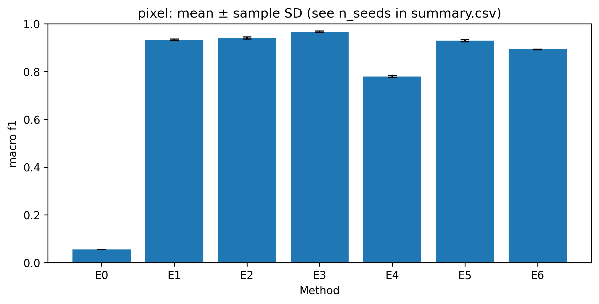
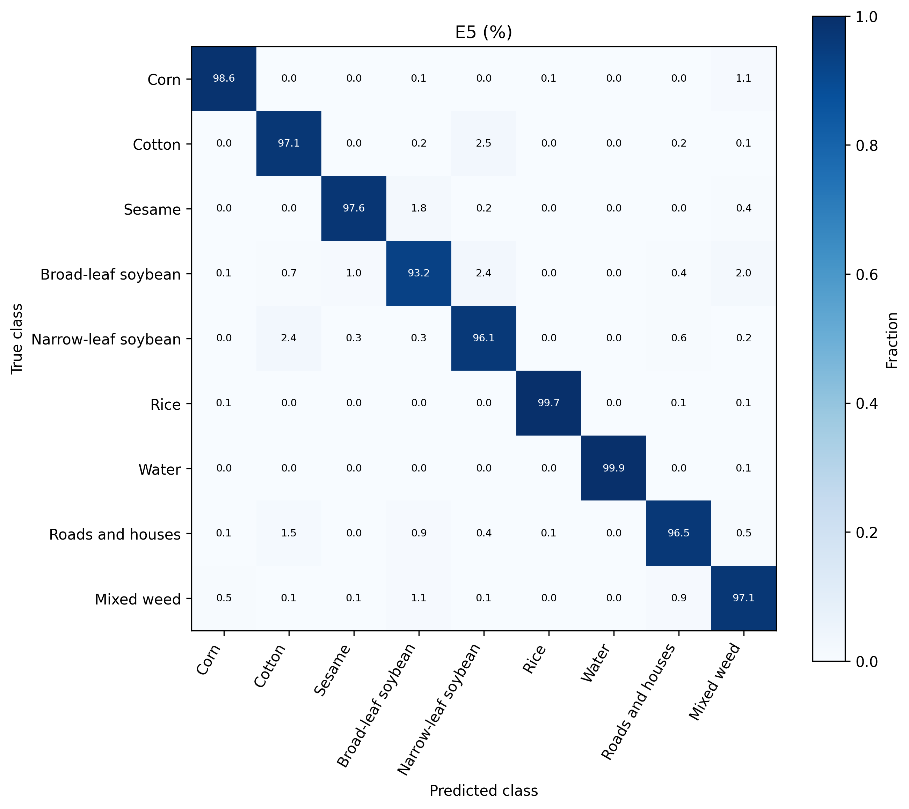
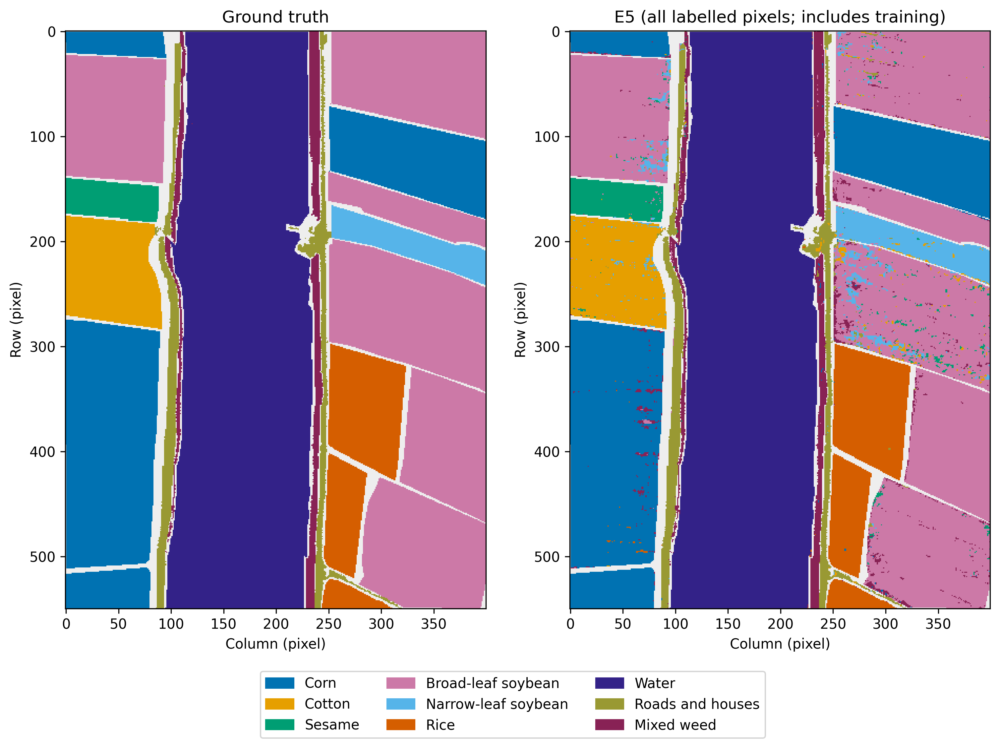
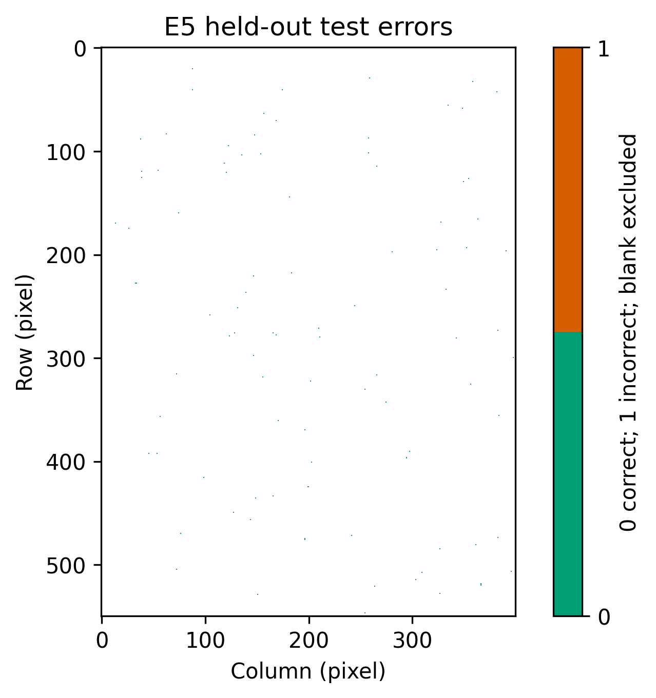
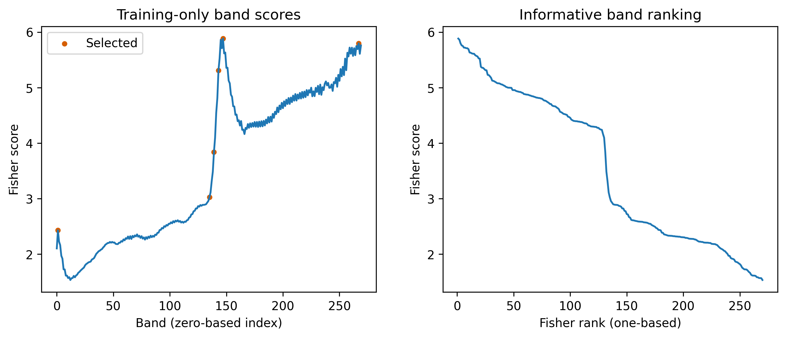

# Spectral–Spatial Feature Selection for Hyperspectral Land-Cover Classification Using an Enhanced SVM

**Pattern Recognition semester project — deadline: 5 November 2026.**

**Himanshu Sinha — S20240020290**

**Ghule Yash Mahesh — S20240020288**

**Execution status:** all seven methods completed on all five predeclared seeds on the Windows experiment device. The saved independent audit reports PASS for 35 evaluations and 155 candidate fits. Results are for a transductive, same-scene random-pixel protocol; documentation updates use these recorded measurements.

## 1. Abstract

This study evaluates classical spectral and spatial features for nine-class land-cover recognition on WHU-Hi-LongKou (550 × 400 pixels, 270 bands). Fisher ranking and strict correlation pruning select bands; local means and standard deviations augment them for an RBF SVM (FRSS-SVM). Seven methods share stratified 70/15/15 partitions, with 9,000 capped training pixels and 30,682 held-out test pixels per seed. Validation macro-F1 selects hyperparameters. Across five seeds, FRSS-SVM achieves 97.131 ± 0.201% accuracy and 92.936 ± 0.476% macro-F1. Its macro-F1 difference from the full-spectrum SVM is -0.307 percentage points. MNF-SVM has the highest mean macro-F1 among the evaluated methods. Reported variability is sample SD across splits, not independent-scene uncertainty.

## 2. Introduction and motivation

Crop mapping can support agricultural inventories and land-use assessment. A hyperspectral pixel contains many closely spaced spectral measurements, which may help distinguish crops but can also be redundant. Spatial context may reduce local ambiguity at the cost of smoothing boundaries. This project examines that trade-off with interpretable feature selection and classical classifiers, avoiding reliance on a GPU.

## 3. Problem statement

Given a cube X ∈ R^(H×W×B), predict one of nine classes for each labelled pixel. The scene's label 0 denotes unlabelled background and is excluded from learning and evaluation. The task is supervised multiclass classification of an agricultural scene, rather than inference on an independently acquired geographic region.

## 4. Objectives and research questions

1. Does supervised, redundancy-aware band selection preserve classification quality with fewer inputs?
2. Do local means and standard deviations improve per-class recognition relative to spectral-only features?
3. How do selected bands compare with PCA and noise-adjusted components under a shared training budget?
4. What accuracy, feature-size and runtime trade-offs arise between SVM and Random Forest?

These questions are assessed using the held-out results in Sections 13-16; improvements are not assumed.

## 5. Related work

Hu et al. introduce WHU-Hi as a benchmark for detailed crop recognition using UAV imagery [1]. The official resource page supplies scene and class metadata [2]. Their published scores are not directly comparable with this project's split and are not reused as our findings.

Chang and Lin describe LIBSVM's support-vector classifiers and multiclass implementation [3]. We use the scikit-learn SVC interface to that classical solver. Green et al. develop a noise-aware image transformation [4]; our implementation follows the noise-whitening/generalized-eigenproblem interpretation rather than renaming ordinary PCA. Breiman's Random Forest combines randomized tree predictors [5], providing an alternative nonlinear classifier. The proposed contribution is an evaluated combination of established tools, not invention of Fisher ranking, local statistics or SVM.

## 6. Dataset and measured distribution

The official LongKou MAT files were downloaded from the publisher's ZIP and checked for size and CRC integrity. Actual variable inspection found a 550×400×270 cube, a 550×400 label map and the counts below, matching the official class table [2]. There are 15,458 background and 204,542 labelled pixels. Thus the dataset exceeds 10 attributes, 1,000 instances and 3 classes.

| ID | Class | Observed labelled pixels |
|---:|---|---:|
| 1 | Corn | 34,511 |
| 2 | Cotton | 8,374 |
| 3 | Sesame | 3,031 |
| 4 | Broad-leaf soybean | 63,212 |
| 5 | Narrow-leaf soybean | 4,151 |
| 6 | Rice | 11,854 |
| 7 | Water | 67,056 |
| 8 | Roads and houses | 7,124 |
| 9 | Mixed weed | 5,229 |

The minimum class is much smaller than the maximum, so macro-F1 and class-wise recall complement overall accuracy. No wavelength calibration vector is assumed by the code; spectral plots label band indices. See `data/DATASET_VALIDATION.json` and `data/DOWNLOAD_PROVENANCE.json` for inspection and hashes.

## 7. Preprocessing and leakage prevention

Pixel splits are stratified 70% training, 15% validation and 15% test, with seeds 7, 19, 42, 73 and 101. The common training pool is capped at 1,000 pixels per class for E1–E6, once per seed. Every fitted mean, standard deviation, Fisher score, correlation, PCA covariance and MNF covariance uses this capped set only. E0 uses original training-pool class proportions to provide the correct majority reference. All actual indices and class counts are persisted at execution time.

Validation labels select configurations; the test set is scored after selection. The winning model is retained without a train+validation refit. Scaling does not use full-scene statistics. Full-scene class spectra and colour stretches are descriptive figures only and do not feed learning. Local statistics use measurements, never labels; random-pixel neighbourhoods can nevertheless share measurements across splits, so this protocol is explicitly transductive and geographically optimistic.

## 8. Mathematical formulation

For band j, with class size n_c, class mean μ_cj, population variance σ²_cj and global training mean μ_j:

F_j = [Σ_c n_c(μ_cj − μ_j)²] / [Σ_c n_c σ²_cj + ε].

The implementation uses ε=10⁻¹² and population within-class variances. Bands are ranked descending, then greedily retained if their absolute training Pearson correlation with every previously retained band is ≤0.95. Constant bands are excluded. Strictly pruned sets are never padded with redundant bands.

PCA diagonalizes the covariance of training-standardized inputs and retains the largest-variance directions. The maximum eligible component count is decomposed once; smaller prefixes are reused. Component outputs are rescaled using training statistics before SVM fitting.

For MNF, training-neighbour differences d_pq=(x_p−x_q)/√2 estimate noise under independent equal-covariance noise and locally smooth signal. Both endpoints belong to the capped training set. Differences are expressed in training-standardized units. With S_n=cov(d), use C_n=S_n+α max(tr(S_n)/B, machine epsilon)I, α=0.001. Solve C_x v=λ C_n v, normalize vᵀC_n v=1 and sort λ descending. This is noise whitening followed by PCA in the whitened space; large λ identifies high total-to-noise variance. At least 300 eligible pairs are required and at most 20,000 are sampled with the recorded seed. Too few pairs stop E3 clearly. This estimator can confound signal edges with sensor noise and does not constitute instrument-specific noise calibration [4].

For binary SVM subproblems, the soft-margin objective is ½||w||²+CΣ_i ξ_i subject to y_i(wᵀφ(x_i)+b)≥1−ξ_i and ξ_i≥0. The RBF kernel is K(x,x′)=exp(−γ||x−x′||²); LIBSVM combines binary subproblems for multiclass prediction [3]. Random Forest predicts through an ensemble of randomized classification trees [5].

## 9. Proposed FRSS-SVM

For each selected band, compute a 3×3 reflected-border local mean m and population standard deviation s. Concatenate z=[x,m,s], giving 3k features for k bands. In the completed run, strict correlation pruning retained six bands in every seed, producing 18 classifier inputs. Statistics are computed only for selected bands. Variance uses double-precision accumulation with roundoff negatives clamped to zero before square roots. Train-only scaling precedes the same RBF-SVM family used in the principal baseline.

## 10. Experimental setup and hyperparameters

| Method | Nominal feature candidates | Model candidates |
|---|---|---|
| E0 | Majority prior, no informative features | Dummy most frequent |
| E1 | All bands | RBF SVM |
| E2 | PCA: 20, 50 components | RBF SVM |
| E3 | MNF: 20, 50 components | RBF SVM |
| E4 | 15, 30, 45, 60 selected bands | RBF SVM |
| E5 | Selected bands with mean/std: 45, 90, 135, 180 features | RBF SVM |
| E6 | Same spatial feature candidate family | RF: 100, 200 trees |

SVM uses C={1,10}, γ={scale,0.01}; RF uses depth≤24 and leaf size≥2. All searches maximize validation macro-F1, with deterministic ties favoring earlier smaller counts. Infeasible dimensions are skipped. If no requested band count survives strict pruning, the entire nonempty pruned set is the predeclared fallback. This occurred in all five seeds: E4 used six bands, and E5/E6 used those six bands with means and standard deviations, for 18 features. An optional linear SVM is disabled by default.

The predeclared upper budget is 305 candidate fits. Strict feature feasibility reduced the actual search to 155 fits, all completed. A 256-MB SVM cache and 4,096-row prediction batches constrain resources. Four bounded workers predict independent batches; classifier fitting and BLAS remain at one thread. Serial/parallel prediction equality was regression tested. The measured environment is Windows, Python 3.12.5, Intel Core i5-12450H, approximately 16 GB RAM; GPU acceleration was not used. Exact dependencies, the run fingerprint, dataset hashes and configuration are preserved in report/evidence/manifest.json and requirements-windows-lock.txt. The fingerprint incorporates source bytes; the manifest does not list individual source-file hashes. The earlier macOS environment in requirements-lock.txt is a separate implementation environment.

## 11. Spatial sensitivity protocol

An additional, opt-in block protocol assigns whole 40×40 pixel blocks to partitions with the configured proportions, then erodes each region by a 2-pixel buffer. Neighbourhood footprints are separated and unit checked. Block splits are not guaranteed class stratification or exact pixel proportions. Missing-class partitions raise an error rather than retrying seeds based on performance. A preflight check on the real scene found missing validation classes for seeds 7, 19 and 73; seeds 42 and 101 were feasible. No block classifiers were trained, and seeds were not replaced or selectively reported. Thus no complete five-seed spatial sensitivity claim is possible with this predefined block design. Random-pixel findings must not be described as independent geographic generalization. Details are in report/evidence/protocol_feasibility.json.

## 12. Evaluation metrics

Overall accuracy is correct predictions divided by test pixels. Class precision is TP/(TP+FP), recall TP/(TP+FN), and F1 their harmonic mean. Macro metrics give equal weight to the fixed nine-class ordering. Undefined ratios become zero consistently. Raw and row-normalized confusion matrices use true rows and predicted columns. Five-run means and sample SD (denominator n−1) are computed from saved measurements; a single run has undefined SD. Completion flags expose missing seeds.

## 13. Measured test results

Accuracy and macro-F1 are percentages; ± denotes sample SD over seeds 7, 19, 42, 73 and 101. Every method used the same test split within a seed.

| Method | Accuracy (%) | Macro-F1 (%) | Features (mean) | Runs |
|---|---|---|---|---|
| E0 Majority | 32.785 ± 0.000 | 5.487 ± 0.000 | 1.0 | 5/5 |
| E1 Full-spectrum SVM | 96.967 ± 0.189 | 93.243 ± 0.362 | 270.0 | 5/5 |
| E2 PCA-SVM | 97.200 ± 0.263 | 94.026 ± 0.444 | 50.0 | 5/5 |
| E3 MNF-SVM | 98.384 ± 0.270 | 96.665 ± 0.365 | 20.0 | 5/5 |
| E4 Selected-band SVM | 89.825 ± 0.290 | 77.947 ± 0.414 | 6.0 | 5/5 |
| E5 FRSS-SVM | 97.131 ± 0.201 | 92.936 ± 0.476 | 18.0 | 5/5 |
| E6 Spatial Random Forest | 95.353 ± 0.148 | 89.254 ± 0.188 | 18.0 | 5/5 |

The highest mean macro-F1 is MNF-SVM (96.665%). FRSS-SVM differs from the full-spectrum SVM by +0.164 accuracy points and -0.307 macro-F1 points. These are descriptive comparisons; no significance test or independent geographic validation is claimed.

## 14. Per-class performance and confusion

The following values are five-seed means in percent. Complete precision, recall, F1 and SD for all seven methods are retained in evidence/per_class_summary.csv.

| Class | E1 recall | E5 precision | E5 recall | E5 F1 ± SD |
|---|---|---|---|---|
| Corn | 99.14 | 99.66 | 98.13 | 98.888 ± 0.271 |
| Cotton | 96.21 | 93.66 | 96.32 | 94.970 ± 0.393 |
| Sesame | 98.33 | 80.77 | 98.41 | 88.699 ± 2.013 |
| Broad-leaf soybean | 92.38 | 99.51 | 93.34 | 96.324 ± 0.255 |
| Narrow-leaf soybean | 96.30 | 66.57 | 95.43 | 78.417 ± 1.578 |
| Rice | 99.66 | 99.65 | 99.75 | 99.702 ± 0.103 |
| Water | 99.92 | 100.00 | 99.95 | 99.975 ± 0.014 |
| Roads and houses | 95.27 | 94.54 | 97.31 | 95.898 ± 0.354 |
| Mixed weed | 97.43 | 73.99 | 95.97 | 83.553 ± 1.088 |

The lowest mean E5 precisions are Narrow-leaf soybean: 66.57% precision versus 95.43% recall; Mixed weed: 73.99% precision versus 95.97% recall. High recall does not imply few false positives. Errors from a large class can noticeably lower a smaller class's precision, which helps explain the gap between overall accuracy and macro-F1.

The largest pooled directed E5 errors are Broad-leaf soybean → Narrow-leaf soybean (1292 predictions); Broad-leaf soybean → Mixed weed (850 predictions); Broad-leaf soybean → Sesame (489 predictions). These counts pool repeated split evaluations, so a scene pixel can contribute more than once. They are not counts of independent pixels across scenes.

## 15. Paired ablation and selected representations

Differences are proposed minus baseline, in percentage points. Each pair shares the seed and exact split digest.

| Comparison | Accuracy difference ± SD | Macro-F1 difference ± SD |
|---|---|---|
| E4-E1 | -7.142 ± 0.463 | -15.297 ± 0.738 |
| E5-E1 | 0.164 ± 0.330 | -0.307 ± 0.749 |
| E5-E4 | 7.307 ± 0.198 | 14.990 ± 0.246 |

Adding local mean/std features to the selected-band family changes macro-F1 by +14.990 ± 0.246 percentage points. Against the full-spectrum SVM the change is -0.307 points, with 93.33% fewer classifier input features on average. Thus recovery of information lost by aggressive band pruning should be distinguished from improvement over all-band classification.

| Seed | E2 PCA | E3 MNF | E4 bands | E5 features | E6 features |
|---|---|---|---|---|---|
| 7 | 50 | 20 | 6 | 18 | 18 |
| 19 | 50 | 20 | 6 | 18 | 18 |
| 42 | 50 | 20 | 6 | 18 | 18 |
| 73 | 50 | 20 | 6 | 18 | 18 |
| 101 | 50 | 20 | 6 | 18 | 18 |

E5/E6 feature counts include raw bands, means and standard deviations, so their band counts are one third of the displayed count. Strict correlation pruning may leave fewer bands than the smallest nominal request; in that case the predeclared fallback uses all retained bands. This is not a post-test hyperparameter change. Every chosen parameter and zero/one-based band index is recorded in evidence/pixel/. E4/E5 searches tune counts independently, so the ablation compares tuned families rather than an enforced fixed-band intervention.

## 16. Runtime and dimensionality

Times are seconds, mean ± sample SD. Selected fit is one winning classifier fit; search includes all candidate fits and validation predictions.

| Method | Selected fit | Preprocessing | Search | Test prediction |
|---|---|---|---|---|
| E0 | 0.028 ± 0.028 | 0.012 ± 0.010 | 0.163 ± 0.215 | 0.110 ± 0.218 |
| E1 | 5.094 ± 1.461 | 0.184 ± 0.158 | 137.535 ± 46.324 | 17.140 ± 5.372 |
| E2 | 3.938 ± 1.528 | 1.134 ± 0.635 | 122.777 ± 49.886 | 12.754 ± 6.219 |
| E3 | 1.505 ± 0.763 | 0.802 ± 0.366 | 73.429 ± 25.890 | 3.620 ± 1.729 |
| E4 | 1.308 ± 0.373 | 0.266 ± 0.147 | 45.328 ± 18.843 | 5.955 ± 2.645 |
| E5 | 0.905 ± 0.499 | 0.267 ± 0.143 | 28.835 ± 11.275 | 3.626 ± 1.720 |
| E6 | 27.876 ± 13.368 | 0.039 ± 0.067 | 200.828 ± 374.086 | 0.903 ± 0.254 |

Caches reuse decompositions and spatial representations. Preprocessing therefore depends on execution order and is not a cold-start benchmark. Test prediction includes batched transformations but excludes reconstruction of the winning spatial cache. Plotting, disk I/O and full-scene maps are excluded. The computer was also used for documentation and verification, so wall times should be treated as practical observations rather than controlled hardware benchmarks.

## 17. Limitations and threats to validity

This is a transductive same-scene experiment. Random-pixel neighbours can share measurements across partitions, and geographic autocorrelation can inflate accuracy. Training-only fitting prevents statistical-transform leakage, but does not make spatially neighbouring test pixels geographically independent. The block protocol failed class coverage on three predeclared seeds; no geographic robustness result is claimed. Repeated test sets overlap. Five-run SD captures split sensitivity, not independent-scene uncertainty. The nearly balanced training cap alters class priors. Local noise differences may include signal edges; spatial statistics can blur boundaries. The small validation grid may miss useful settings. The proposed method combines established algorithms and does not introduce a new SVM optimization objective.

## 18. Conclusion

All 35 method/seed evaluations completed and passed independent prediction-based checks. FRSS-SVM achieved 97.131 ± 0.201% accuracy and 92.936 ± 0.476% macro-F1. Relative to the full-spectrum SVM, its macro-F1 changed by -0.307 percentage points while using 18.0 features on average versus 270. The best observed mean macro-F1 belongs to MNF-SVM. Future work should predeclare a class-covering geographic split, use an independent scene, and compare matched-band spatial ablations.

## 19. Verified references

1. X. Hu, Y. Zhong, C. Luo and X. Wang. *WHU-Hi: UAV-borne hyperspectral with high spatial resolution (H2) benchmark datasets for hyperspectral image classification*. arXiv:2012.13920, version 2, 2021. [Author preprint](https://arxiv.org/abs/2012.13920).
2. Wuhan University RSIDEA. *WHU-Hi resource sharing*. [Official dataset and class table](https://rsidea.whu.edu.cn/e-resource_WHUHi_sharing.htm), checked 29 October 2026.
3. C.-C. Chang and C.-J. Lin. *LIBSVM: A Library for Support Vector Machines*. ACM Transactions on Intelligent Systems and Technology, 2011. [Author-maintained paper, updated 2022](https://www.csie.ntu.edu.tw/~cjlin/papers/libsvm.pdf).
4. A. A. Green, M. Berman, P. Switzer and M. D. Craig. *A Transformation for Ordering Multispectral Data in Terms of Image Quality with Implications for Noise Removal*. IEEE Transactions on Geoscience and Remote Sensing, 1988. [Publisher record, DOI 10.1109/36.3001](https://doi.org/10.1109/36.3001); [indexed original paper scan](https://citeseerx.ist.psu.edu/document?doi=6ae00ebd3a91c0667c79c39035b5163025bcfcad&repid=rep1&type=pdf). Title/authors/year were verified in the indexed original-paper excerpt; the publisher full text and scan fetch were inaccessible in this environment.
5. L. Breiman. *Random Forests*. Machine Learning, 2001. [Author-hosted original paper](https://www.stat.berkeley.edu/users/breiman/randomforest2001.pdf).

These references establish method origins; the performance reported above comes solely from this project's saved experiments. No unverified DOI or accuracy claim is added.

## 20. Contributions and reproducibility appendix

 The responsibilities below record that allocation; they do not claim separate commit authorship or independently logged execution by each member. Both members share responsibility for reviewing and explaining the complete submission.

| Team member | Roll number | Share | Allocated responsibilities |
|---|---|---|---|
| Himanshu Sinha | S20240020290 | 50% | Problem formulation and related work; Fisher ranking and correlation pruning; spectral/spatial SVM methodology; baseline and ablation interpretation; methodology and discussion sections of the report; joint presentation and final review. |
| Ghule Yash Mahesh | S20240020288 | 50% | Dataset provenance and validation; train/validation/test protocol and leakage checks; PCA/MNF and Random Forest comparisons; metric auditing, plots and reproducibility; experimental-results and implementation documentation; joint presentation and final review. |

Shared evidence: the implementation modules in `src/`, the regression suite in `tests/`, `report/evidence/manifest.json`, the per-seed results and selection audits in `report/evidence/pixel/`, the saved independent `report/evidence/audit.json`, and `IMPLEMENTATION_LOG.md`. The completed Windows run records 35 method/seed evaluations and 155 candidate fits. These artifacts establish the recorded project work; they do not establish individual human authorship. The 5 November documentation update uses these saved results and adds no new research run.

Project source: [source repository](https://github.com/himanshu09120/Spectral-Spatial-Feature-Selection-for-Hyperspectral-Land-Cover-Classification-Using-an-Enhanced-SVM). The completed study is preserved in the version-controlled report/evidence and report/figures directories. Local commit history does not establish the current remote publication or submission status.

For future reproduction from a prepared Python environment, use `python scripts/download_data.py`, then `python -m src.main --run --allow-training`. In MATLAB, `Main` starts the complete pipeline and displays summary tables and figures. Exact matching completed outputs resume without retraining; source, configuration, dataset or Python/package incompatibility requires a fresh output directory. The committed evidence alone is not a resumable experiment. These are reproduction instructions, not commands executed for the documentation update.

Run fingerprint: `58f8e5ab00fe15cd0179328ae11b7572fce15e3f9eee8fd23e1ddad0142f824b`. The report/evidence bundle retains the manifest, saved independent audit, all per-seed metrics, configuration selections, band indices, class summaries and paired ablations. Large model files, split indices and pixel prediction arrays remain under ignored outputs/ on the experiment device. They are absent from this Mac checkout. The 5 November documentation update preserves the saved measurements and audit; it does not repeat the prediction-based verification.

`python scripts/finalize_report.py` requires the full original outputs/ tree and a compatible execution fingerprint to repeat the audit and regenerate the empirical report, evidence and slide outline. `python scripts/render_report.py` requires the Markdown report, committed figures and optional requirements-report.txt dependencies to export the PDF. It does not require model fitting. The checked-in PDF and PowerPoint are saved exports and were not regenerated for this documentation update; the finalizer does not generate the PowerPoint.

The saved SHA256SUMS.json describes the original Windows export bytes. CRLF-to-LF conversion changes the byte hashes of its 99 text files without changing the recorded metric values; the eight figure hashes are unaffected. The original evidence and checksum record are retained.
